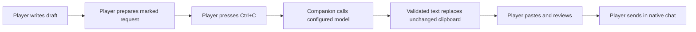

# Architecture and review notes

This document describes the shipped source, not a Blizzard endorsement or a claim about any account's historical behavior. The current implementation is v0.5.0. Game-client integration remains unverified while the Forever test environment is unavailable.

## Player-controlled flow

The addon has no HTTP client and does not read the system clipboard. It creates an editable marked request. The Windows companion watches clipboard sequence changes every 100 ms, reads bounded Unicode text, and checks the request marker. Unmarked copied text may be briefly read to inspect the marker, but is not sent to a model or saved by this project.

The companion replaces the clipboard only after checking the sequence and exact original request while holding the clipboard lock. Copying something else, pausing, or changing configuration invalidates an older result. A failed, refused, oversized, or disallowed output is not automatically retried or sent.

The addon can place reviewed text in the native chat edit box after the player clicks the explicit button. It does not press Enter. If that UI operation is unavailable or blocked, the player can paste manually. The addon cannot cancel an external HTTP request after a zone change; the player must prepare and copy a fresh request and inspect the pasted result.

## Scene context

The addon passively records up to ten distinct, readable non-player target names from explicit target changes. Retargeting a name moves it to the front. Main-zone/world transitions clear the list. No GUID, combat log, damage, kill attribution, automatic targeting, or player identity inference is used by this collector.

Location and party name/class snapshots are collected when the player clicks Read Background. Restricted or unreadable values are skipped. The local target list is maintained even while normal mode is selected, but context is included in a model request only in manually selected expressive mode. Normal requests remove context at both preparation and API layers.

NPC names are scene hints, not evidence of hostility, kills, skill, party membership, or the player's current target. The model is instructed to preserve the source message's requirements, uncertainty and intent. Topic boundaries and output checks reduce mistakes; they do not replace the player's review.

## Data and credentials

- The configured provider receives the draft, persona instructions, selected language/mode, and optional expressive context. This can include party character names and classes if the player includes a snapshot.
- Drafts, context and recent results stay in memory. The companion does not write chat logs or persist target history.
- Non-secret model settings are saved in ignored settings.json. A session key can be entered in the settings UI or supplied through the configured environment variable.
- Automatic key.txt loading is restricted to the exact official OpenAI endpoint. A manually supplied or configured environment key is used with the endpoint selected by the user; users should review that configuration.
- OpenAI requests specify store=false. That request setting is not a claim about the provider's entire data-retention policy.
- Live evaluation tools require an explicit --live argument and use fixed synthetic drafts. Committed evaluation records contain synthetic inputs, not a user's chat history or credentials.

## Source map

| Component | Review focus |
|---|---|
| addon/ForeverRP/RecentTargets.lua | Passive target reads, player/restricted-value filtering, ten-name recency list and zone reset |
| addon/ForeverRP/Context.lua | Explicit location and party snapshots |
| addon/ForeverRP/Core.lua | Request encoding and pasted-result validation |
| addon/ForeverRP/UI.lua | Manual prepare/copy/paste flow, stale-preview checks, chat edit-box fill only |
| companion/core.py | Prompt, request parsing, HTTP calls and output checks |
| companion/clipboard.py | Windows clipboard allocation, locking and final compare/replace |
| companion/app.py | Clipboard polling, worker completion, explicit settings and mode controls |
| tests/ | Local HTTP fakes, coordinator checks, optional Lua 5.1 simulations |

The ctypes allocations, locks and memmove in clipboard.py operate on the companion's Windows clipboard buffers. They do not open a game process or access game memory. There are no keyboard hooks, simulated gameplay inputs, network interception or injection mechanisms in the shipped implementation.

## Evidence and limits

The v0.5 local suite has 72 checks, including 20 Lua simulations when the optional developer-only Lupa runtime is installed. Historical live-model reports document their exact prompt hashes and test inputs; they do not certify subsequent prompts or game-client operation. The CI workflow runs local tests and packaging without API keys or paid model calls.

The source manifest and package checks allow a reviewer to relate source files to the published source bundles. A Git tag identifies a revision; hashes identify particular file bytes. Neither proves which software someone actually ran, guarantees account safety, or resolves naming/chat-content policy questions. Blizzard retains its own policy and enforcement decisions.
